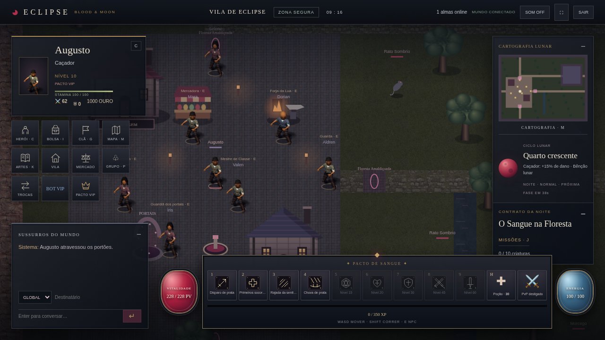
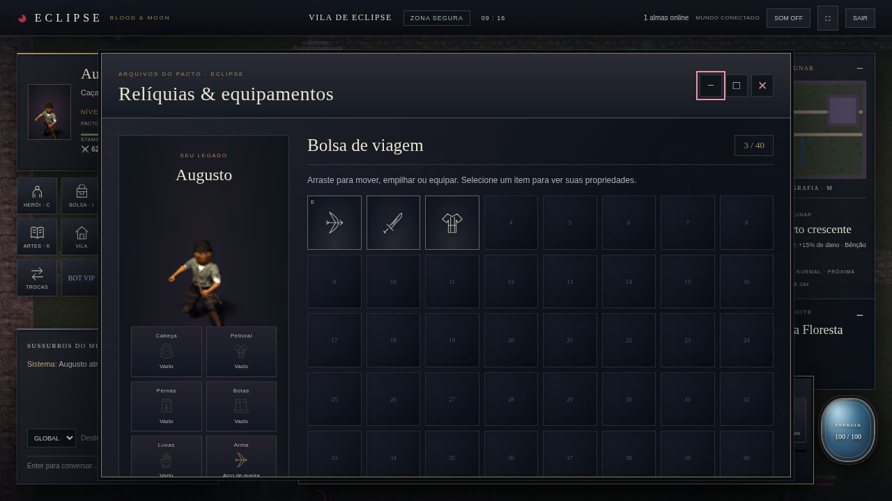

# Fase 2 — primeira integração de interface

Esta é a primeira entrega funcional da fase, não a conclusão de todos os visuais.
A direção e os problemas de origem estão em [Fase 1](REDESIGN-FASE-1.md).

## Alterado

A folha immersive.css foi reestruturada em blocos legíveis, com tokens de ferro,
prata, sangue, dourado e azul lunar. A HUD ganhou hierarquia de identidade, menu,
cartografia, alvo, chat e barra de combate. O menu deixou de sobrepor a coluna da lua.
O tracker de missão agora flui dentro da cartografia: texto de clima variável não
faz as duas áreas se sobreporem. Hotbar desktop em linha, XP e recursos redesenhados.

## Criado e integrado

- Controles de minimizar/restaurar/maximizar no dialog real, preservando painel e
  seus dados. Atalhos e abertura por NPC continuam usando o fluxo existente.
- Cartografia e missão recolhíveis; chat já recolhível ganhou novo tratamento.
- Inventário dividido entre loadout com personagem e bolsa 8×5. Dez equipamentos
  continuam funcionais; ações e drag/drop usam os mesmos comandos do servidor.
- 21 ícones SVG originais, servidos pelo cliente local e Vite, para os itens do catálogo.
- Células da bolsa acessíveis por Tab/Enter/Espaço para inspecionar itens.
- Nova linguagem de cartões/controles para status, skills e missões. Os próximos
  incrementos devem diferenciá-los mais profundamente, não apenas recolorir cartões.

## Validado

Check de sintaxe/TypeScript, build Vite e os 107 testes de gameplay/integração.
Chromium com banco temporário: login, seleção, criação de personagem, dois jogadores,
40 células, dez equipamentos, quatro quests, maximizar/minimizar/restaurar e recolher
cartografia. Screenshots em 390×844, 800×720, 1280×720 e 1920×1080. Isso valida layout
nas resoluções verificadas, não garante suporte completo a toda interação touch.

## Ainda falta

Arte de abertura/login/seleção; composições finais próprias de status/skills/quests;
ícones restantes de ferramentas; HUD ajustável pelo jogador; polimento de escalas
mobile e leitura em todas as condições de clima. Personagens, monstros, tiles e
animações do mundo não foram substituídos nesta fase. Não confundir a prévia do
personagem da bolsa com novos atlas de sprite.

## Arquivos

- index.html: estrutura, controles e agrupamento de cartografia/missão.
- mmo/immersive.css: sistema visual e layouts responsivos.
- mmo/window-ui.js: novo módulo de minimizar/maximizar/recolher.
- mmo/client.js: inicialização e restauração de janelas ao abrir painéis.
- mmo/game-ui.js: impedir arrastar janela maximizada.
- mmo/inventory-ui.js: layout, retrato, SVGs e inspeção por teclado.
- assets/ui/item-icons.svg: 21 ícones originais.
- server.js: allowlist dos novos recursos públicos.
- README.md e docs/REDESIGN-FASE-1.md: escopo e instruções.

O banco, schema, snapshots e protocolo não foram alterados pelo redesign.
